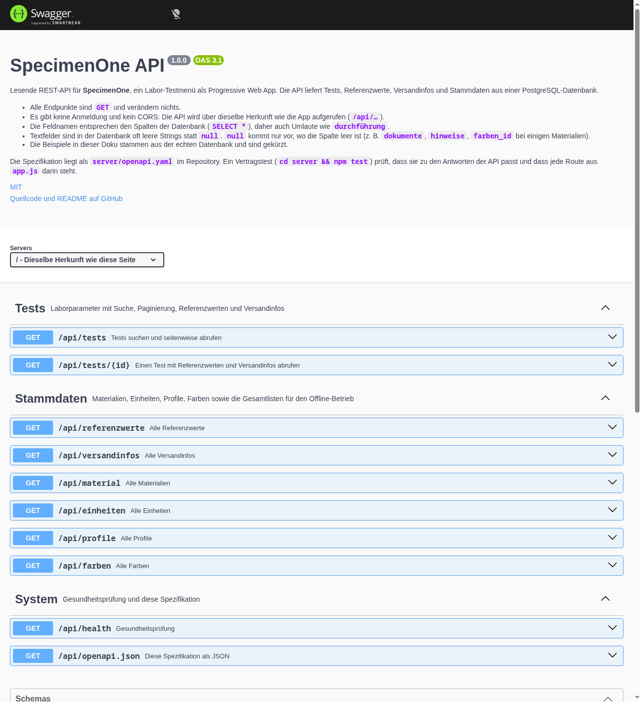

# SpecimenOne

React-Web-App (PWA) zur Anzeige des Labor-Leistungsverzeichnisses: Tests, Referenzwerte, Materialien und Profile für medizinisches Personal.

## Funktionen

- Suche über Testname, Synonyme, Material, Fachbereich, LOINC-Code und Test-ID
- Detailansicht je Test mit Referenzwerten (alters-, geschlechts- und zustandsabhängig), Material, Abrechnung (EBM/GOÄ) und Versandinfos
- Drei Ansichten: Einzeltests, Test-Profile, hierarchische Tabelle nach Fachbereich
- Persönliche Profile per Checkbox-Auswahl, gespeichert im Browser; optional Meldung per Discord-Webhook
- Druckansicht für Testdetails und Profile
- Dark Mode, farbcodierte Fachbereiche und Material-Badges
- PWA: installierbar, vollständig offlinefähig mit Offline-Hinweis (siehe [PWA und Offline-Betrieb](#pwa-und-offline-betrieb))

## Architektur

```
Browser ──/api/*──▶ nginx (Image specimenone) ──▶ api:3001 (Image specimenone-api) ──▶ PostgreSQL
          sonst ──▶ statische App
```

| Teil | Technik | Ort |
| --- | --- | --- |
| Frontend | React 18, Vite, Tailwind, Material Web | `src/`, `public/`, `Dockerfile`, `nginx.conf` |
| API | Node 22, Express, pg (nur lesend) | `server/` (siehe `server/README.md`) |
| Datenbank | PostgreSQL 17 | Container im Stack, Daten auf dem Host |

Das Frontend ruft die API **relativ** unter `/api` auf (`src/services/apiConfig.js`, überschreibbar mit `VITE_API_BASE_URL` beim Build). In Produktion leitet nginx `/api/` an den Compose-Service `api` weiter, in der Entwicklung macht das der Vite-Proxy.

## API

Die API ist lesend (nur `GET`) und mit OpenAPI 3.1 dokumentiert:

- **Interaktive Doku** (Swagger UI, „Try it out“ gegen dieselbe Herkunft): [`/api/docs`](https://one.madmoench.de/api/docs)
- **Spezifikation** als JSON: [`/api/openapi.json`](https://one.madmoench.de/api/openapi.json)
- **Quelle** im Repo: [`server/openapi.yaml`](server/openapi.yaml)



Die Spezifikation ist die einzige Endpunktliste. **Neue Routen müssen in `server/openapi.yaml` nachgetragen werden:** Der Vertragstest (`server/openapi.test.js`, läuft mit `cd server && npm test` und in der CI) schlägt fehl, wenn `app.js` eine Route hat, die nicht in der Spezifikation steht (oder umgekehrt), wenn die Beispiele nicht zu den Antworten passen oder die Version nicht zu `server/package.json` passt. Gegen die echte Datenbank lässt sich der Vertrag einmalig mit `node server/scripts/vertrag-live.js http://localhost:3001` prüfen (laufende API mit DB nötig).

## PWA und Offline-Betrieb

Die App ist installierbar (Manifest `/manifest.webmanifest`, erzeugt von `vite-plugin-pwa` in `vite.config.js`) und funktioniert nach dem ersten Online-Besuch ohne Verbindung.

**Offline verfügbar** (nach einem Online-Start, ohne dass einzelne Ansichten geöffnet sein müssen):

- App-Shell, Fonts, Icons und alle Build-Chunks, auch die Grafiken (`TimelineView`, vorab gecacht, aber weiterhin erst beim Öffnen geladen)
- Testliste, Profile, Materialien, Einheiten
- Testdetails **aller** Tests inklusive Referenzwerte und Versandinfos: Die App lädt beim Start einmal `/api/referenzwerte` und `/api/versandinfos` (`src/contexts/DetailDataContext.jsx`). `/api/tests/:id` dient nur noch als Rückfall, falls diese Gesamtdaten fehlen.
- Persönliche Profile (liegen ohnehin im `localStorage`)

**Wie aktuell sind die Daten?** API-Antworten laufen über `StaleWhileRevalidate`: Die App zeigt sofort den Cache-Stand und lädt im Hintergrund nach, die neue Version erscheint beim nächsten Start. Gecacht werden nur Antworten mit Status 200. Ein Eintrag bleibt **30 Tage** gültig, gerechnet ab der letzten erfolgreichen Online-Antwort. Wer die App 30 Tage lang nie online öffnet, hat danach keine Offline-Daten mehr. Da sich die Daten praktisch nie ändern, ist der Cache-Stand in der Regel aktuell.

**Offline-Hinweis:** Ohne Verbindung zeigt die App oben ein Banner „Offline – angezeigte Daten vom TT.MM.JJJJ, hh:mm“ (`src/components/OfflineBanner.jsx`). Grundlage sind `navigator.onLine` mit den Events `online`/`offline` und eine kurze Erreichbarkeitsprüfung gegen `/api/health` (Timeout 3 s, vom Service-Worker nicht gecacht), denn bei „Lie-Fi“ oder nicht erreichbarem Server meldet der Browser weiterhin „online“. Solange die App offline ist, prüft sie alle 15 s erneut. Das letzte Prüfergebnis wird gemerkt, damit das Banner beim nächsten Start ohne Verbindung sofort erscheint. Der Zeitpunkt der letzten erfolgreichen Prüfung steht in `localStorage` unter `specimenOne.lastOnlineSync`.

**Prüfen:** `scripts/offline-check.mjs` testet das Offline-Verhalten mit Chromium über CDP gegen lokale Container auf `http://localhost:8199/`, siehe Kommentar im Skriptkopf. Es misst die Startzeit, wenn die Verbindung sofort fehlschlägt (Container gestoppt) und wenn sie hängt (Server antwortet nie). Außerdem prüft es Testdetails, Grafiken, Banner und Konsole und legt Screenshots in `docs/screenshots/` ab.

## Mobil und Barrierefreiheit

- **Mobile Startansicht (≤ 767 px):** Die Suche klebt oben (`sticky`), die Sortierung steckt hinter dem Knopf „Sortierung: …“, die Ansichten (Tests, Profile, Tabelle, Grafiken) sind eine waagerecht scrollbare Leiste, die Seitennavigation heißt kompakt „‹ 1/30 ›“. Die erste Testkarte beginnt auf 390 × 844 bei 353 px (Willkommenshinweis geschlossen). Ab `md` bleibt die Sortierung sichtbar.
- **Seitengröße 50 statt Virtualisierung:** `src/utils/seitenaufteilung.js` (`ITEMS_PER_PAGE = 50`). Eine Seite sind rund 1000 DOM-Elemente (vorher 3400 bei 200 Karten). Gegen eine Virtualisierung sprach: Strg+F, Tastatur- und Screenreader-Navigation und das responsive Raster bleiben unverändert, und es kommt keine Abhängigkeit dazu.
- **Layout-Verschiebung:** Solange die Liste lädt, zeigt `ListenSkeleton` (App.jsx) Platzhalter-Karten mit mindestens Bildschirmhöhe; Suche, Sortierung und Ansichten stehen sofort. Alle `` haben `width`/`height`.
- **Kontrast (WCAG AA):** Kopfzeile `bg-header` (`#2b7a40` / dunkel `#1e4d2b`), Fachbereichs-Badges und Material-Badges mit angepassten Farben bei gleichem Farbton. `scripts/kontrast-fix.py` hat `kategorie-badges.css` und `material-badges.css` umgerechnet (Mindestkontrast 4,6:1); die Dunkel-Regeln hängen jetzt an `.dark-theme` statt an `prefers-color-scheme`.
- **Tastatur:** Testkarten haben einen Namensknopf (`.test-open`) über die ganze Karte, Checkboxen heißen „<Testname> für Profil auswählen“, Fokusrahmen in `src/styles/a11y.css`. Die Detailansicht ist ein Dialog (`role="dialog"`), Escape schließt sie, der Fokus geht beim Öffnen hinein und beim Schließen zurück.
- **Prüfen:** `scripts/ux2-check.mjs` (gleicher Containeraufbau wie `offline-check.mjs`) misst Kartenposition, DOM, Kontrast aller Texte in hell/dunkel, Tastaturbedienung und legt `docs/screenshots/ux2-*.png` ab. Lighthouse: `npx -y lighthouse@12 http://localhost:8199/ --chrome-path=$(which chromium) --chrome-flags="--headless=new --no-sandbox"` (mit `--preset=desktop` für Desktop).

## Entwicklung

Voraussetzung: Node.js 22.

```bash
npm ci
(cd server && npm ci && npm start)   # API auf :3001, DB-Default styx:5433
npm run dev                          # Vite auf :5173, /api -> localhost:3001
```

Qualitätssicherung (läuft auch in der CI):

```bash
npm run lint                  # ESLint (Flat Config, React-Hooks- und Refresh-Regeln)
npm test                      # Vitest: Filter-/Sortierlogik der Testliste, Gruppierung der Detaildaten
npm run build                 # Produktions-Build nach dist/
(cd server && npm test)       # API-Tests (node:test + supertest, DB gemockt, keine Datenbank nötig)
```

Die DB-Verbindung der API kommt aus `PGHOST`, `PGPORT`, `PGUSER`, `PGPASSWORD`, `PGDATABASE`. Ein anderes API-Ziel für den Vite-Proxy: `API_PROXY_TARGET=http://host:3001 npm run dev`.

## Build und Deployment

```bash
./scripts/build-push.sh            # baut beide Images und pusht nach Docker Hub (madmoench/…)
./scripts/build-push.sh --no-push  # nur bauen
```

`compose.yaml` ist der Produktiv-Stack (Frontend `:8100`, API ohne Host-Port, PostgreSQL `:5433`). Optionale Umgebungsvariable im Frontend: `VITE_DISCORD_WEBHOOK_URL` (landet zur Laufzeit in `config.js`, siehe `docker-entrypoint.sh`).

Der Discord-Webhook ist kein Build-Bestandteil: `src/services/ServiceClient.js` liest ihn nur zur Laufzeit aus `window.SPECIMENONE_CONFIG.DISCORD_WEBHOOK_URL`. Ohne Webhook meldet die App „nicht eingerichtet“. Der Build braucht keine lokalen Zusatzdateien: `npm ci && npm run build` genügt.

### CI (GitHub Actions)

[](https://github.com/Sierra-Bravo-ger/SpecimenOne/actions/workflows/ci.yml)

`.github/workflows/ci.yml` läuft bei jedem Push und Pull Request:

1. Frontend: `npm ci`, `npm run lint`, `npm test`, `npm run build`
2. API: `npm ci`, `npm test`
3. Beide Docker-Images bauen (ohne Push)
4. Nur auf `main`: Images nach Docker Hub pushen, **sofern** die Secrets gesetzt sind. Ohne Secrets wird dieser Schritt übersprungen, der Lauf bleibt grün.

Secrets für den Docker-Hub-Push anlegen: Repository → **Settings** → **Secrets and variables** → **Actions** → **New repository secret**. Zwei Secrets mit exakt diesen Namen:

| Name | Wert |
| --- | --- |
| `DOCKERHUB_USERNAME` | Docker-Hub-Benutzername (`madmoench`) |
| `DOCKERHUB_TOKEN` | Access Token aus Docker Hub → Account Settings → Personal access tokens (Rechte: Read & Write) |

## Projektstruktur

```
├── src/                 React-App (components, services, contexts, styles, utils)
├── public/              statische Dateien, Icons, Fonts, Laufzeit-Konfiguration (config.js)
├── server/              REST-API (Express + PostgreSQL)
├── docs/                Entwicklungsnotizen (Theming, Material-Badges, persönliche Profile)
├── scripts/
│   ├── build-push.sh    Images bauen und pushen
│   ├── offline-check.mjs  Offline-Prüfung mit Chromium (CDP)
│   ├── ux2-check.mjs      Mobil-/Barrierefreiheitsprüfung (CDP, Screenshots)
│   ├── kontrast-fix.py    Kontrast-Umrechnung der Badge-Farben
│   └── legacy/          PowerShell-Werkzeuge aus der JSON/CSV-Zeit inkl. Import nach PostgreSQL
├── .github/workflows/   CI (Lint, Tests, Build, Docker)
├── Dockerfile           Frontend-Image (Build + nginx)
├── nginx.conf           SPA + /api-Proxy
└── compose.yaml         Produktiv-Stack
```

## Rechtliches

- **Impressum:** liegt im Portfolio, <https://sebastian-bride.pages.dev/impressum>; der Footer-Link „Impressum“ führt dorthin.
- **Datenschutz:** statische Seite [`public/datenschutz.html`](public/datenschutz.html), erreichbar unter `/datenschutz.html` (Footer-Link „Datenschutz“). Sie ist eigenständig (hell/dunkel, keine externen Ressourcen), von der SPA-Navigation ausgenommen (`navigateFallbackDenylist` in `vite.config.js`) und wird von nginx direkt ausgeliefert. Gelb markierte Stellen (`.platzhalter`) sind noch zu prüfen. Kein Rechtsrat.

## Willkommenshinweis

Erstbesucher sehen über der Suche einen kompakten Hinweis (`src/components/WillkommenHinweis.jsx`): Kurzbeschreibung, vier Beispielsuchen als Chips (Lanoxin, Creatinin, Mycoplasma pneumoniae, F37) und „Über das Projekt“ (Stack und Links zu GitHub, API-Doku, Portfolio). Mit dem × wird er ausgeblendet; das merkt sich die App in `localStorage` (`specimenOne.willkommenAusgeblendet`, `src/hooks/useWillkommen.js`). Danach erscheint im Header ein „?“, das den Hinweis wieder einblendet.

## Lizenz

MIT, siehe [LICENSE](LICENSE). Lizenzen der Abhängigkeiten: [LICENSES.md](LICENSES.md).
